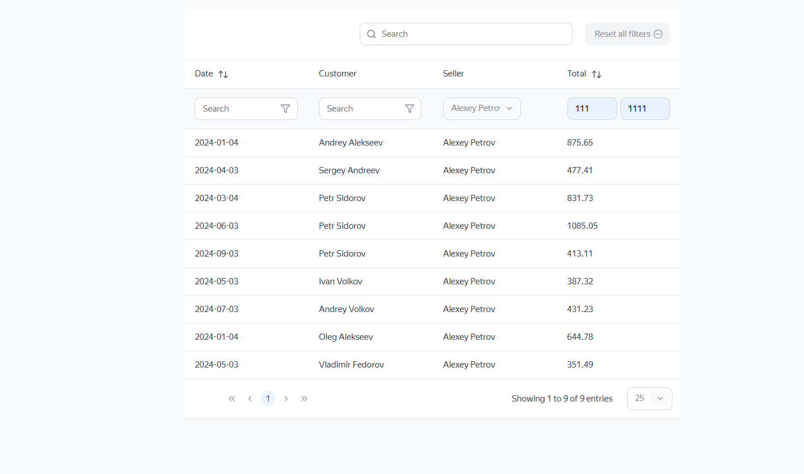

# Smart Table

Переиспользуемый компонент таблицы данных на Vanilla JavaScript с поиском, фильтрацией, сортировкой и пагинацией. Построен на модульной архитектуре без фреймворков.

## Демо

- GitHub Pages: https://alexandrookunev.github.io/smart-table/

## Стек

- Core: Vanilla JavaScript (ES6+), Vite
- Архитектура: модульная (отдельные модули для поиска, фильтрации, сортировки, пагинации), API-абстракция для работы с данными
- Стили: CSS
- CI/CD: GitHub Actions, GitHub Pages

## Функционал

- Поиск по тексту в ячейках
- Фильтрация по выбранным значениям (например, по продавцам)
- Сортировка по колонкам (дата, сумма)
- Пагинация с настраиваемым количеством строк на странице
- Модульная структура: каждый компонент (поиск, фильтр, сортировка, пагинация) — независимый модуль, что упрощает тестирование и расширение

## Структура проекта

    src/
    ├── components/
    │   ├── table.js          # Рендер таблицы
    │   ├── searching.js      # Модуль поиска
    │   ├── filtering.js      # Модуль фильтрации
    │   ├── sorting.js        # Модуль сортировки
    │   └── pagination.js     # Модуль пагинации
    ├── lib/
    │   └── utils.js          # Утилиты (processFormData)
    ├── data/
    │   └── dataset_1.js      # Тестовый датасет
    ├── data.js               # API-абстракция (initData, getRecords)
    ├── main.js               # Точка входа, инициализация
    └── style.css             # Стили

## Запуск локально

Требования: Node.js 18+

1. Установка:

        git clone https://github.com/AlexandroOkunev/smart-table.git
        cd smart-table
        npm install

2. Режим разработки:

        npm run dev

3. Продакшен-сборка:

        npm run build

## Исходные материалы (Яндекс Практикум)

- Макет в Figma и чеклист доступны в материалах курса.